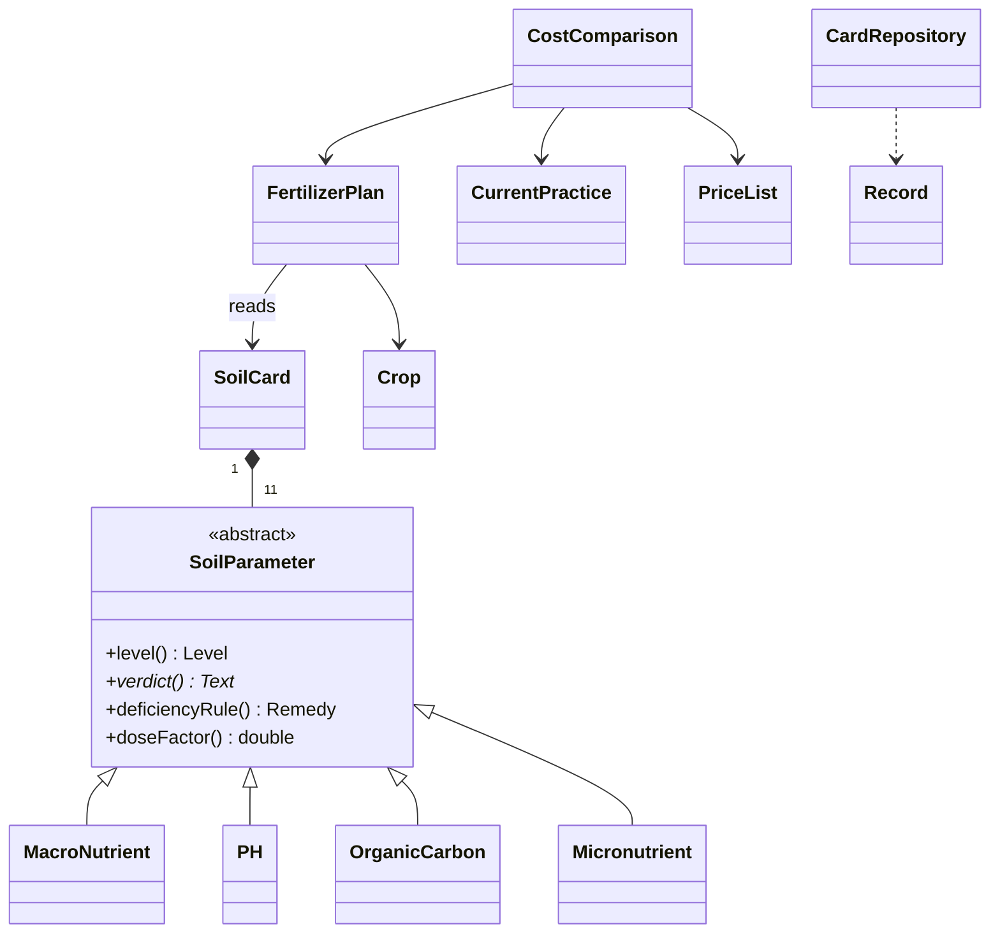

# MittiMitra - Soil Health Card Translator

A C++17 console tool that turns the lab table on a farmer's **Soil Health Card** into plain-language verdicts,
a corrected fertilizer plan and the rupees saved per acre. The whole interface works in **English or Marathi**.
Every analysis is saved to CSV, and a village-level summary shows the community-wide impact.

## Features
- Verdict for each of 11 card parameters (pH, organic carbon, N, P, K, S, Zn, B, Fe, Mn, Cu)
- Corrected Urea / DAP / MOP plan for six crops, with gypsum and micronutrient fixes where the soil is deficient
- Before / after cost per acre and for the whole farm, including an honest "extra spend" case
- Farmer history across seasons, and a village impact summary
- Rules, crop doses and prices are CSV files you can edit without recompiling

## Build and run
Needs a C++17 compiler (GCC 7 or newer; on Windows use MSYS2 UCRT64 GCC). Run everything from the project folder,
because the program reads `data/*.csv`.

```
g++ -std=c++17 -Iinclude src/main.cpp -o mittimitra
./mittimitra                       # Windows PowerShell: .\mittimitra.exe
```
Unit tests:
```
g++ -std=c++17 -Iinclude tests/test_mittimitra.cpp -o run_tests
./run_tests                        # Windows PowerShell: .\run_tests.exe
```
Or with CMake: `cmake -S . -B build` then `cmake --build build`, and run the executable from the project folder.

Menu: 1 new analysis, 2 quick demo, 3 farmer history, 4 village impact, 5 switch English / Marathi, 0 exit.
Ready-made inputs are in [docs/demo_values.md](docs/demo_values.md). For Marathi on Windows use Windows Terminal or the
VS Code terminal (the old cmd window cannot draw Devanagari).

## How it works
Soil card -> each parameter judges itself (low / adequate / high) -> crop reference dose is scaled by what the soil
already holds (low: +25%, high: -25%) -> nutrients converted to Urea / DAP / MOP (DAP's nitrogen is credited) ->
deficiencies add gypsum or micronutrient salts -> compared with what the farmer applies today and priced in rupees.

## Class design


| OOP idea | Where |
|---|---|
| Abstraction + polymorphism | `SoilParameter::verdict()` / `deficiencyRule()` / `doseFactor()` overridden per type |
| Inheritance | `MacroNutrient` (N, P, K), `PH`, `OrganicCarbon`, `Micronutrient` (S, Zn, B, Fe, Mn, Cu) |
| Composition | `SoilCard` owns its parameters through `unique_ptr` |
| Factory | `SoilCard::make()` picks the class from the parameter key |
| Encapsulation | protected state in `SoilParameter`, private data in plan / comparison / repository |
| Association | `FertilizerPlan` uses `SoilCard`; `CostComparison` uses `PriceList` |
| File handling | `CardRepository` (history CSV), `readCsv` (rule tables) |

## Project layout
```
include/   SoilParameter.hpp  Plan.hpp  CardRepository.hpp  Util.hpp
src/       main.cpp (menus and screens)
tests/     test_mittimitra.cpp
data/      thresholds.csv  crops.csv  products.csv  history.sample.csv
docs/      demo_values.md
```

## Data
Edit `data/thresholds.csv` (soil ratings, micronutrient fixes), `data/crops.csv` (reference doses in kg/ha) and
`data/products.csv` (Rs per kg). Your own analyses are saved to `data/history.csv`, which is git-ignored so farmer
names never reach GitHub. `data/history.sample.csv` holds fictional farmers: copy it to `data/history.csv` to try
the history and village features.

## Disclaimer
Thresholds, doses and prices are indicative values for a college project. Confirm them against your local KVK /
agricultural university recommendations before using the advice on a real farm.